# VÉRTICE — Testes Funcionais e Apresentação Final

## 1. Introdução

Este documento apresenta a validação funcional e documental do sistema VÉRTICE, desenvolvido para o Laboratório 02 da disciplina Desenvolvimento e Integração de Aplicações Web, do curso de Engenharia de Software da PUC Minas.

A validação contempla os principais requisitos do sistema, considerando as funcionalidades implementadas, os quatro perfis de usuário e os fluxos de aluguel de automóveis.

## 2. Ambiente

| Item | Tecnologia |
|---|---|
| Front-end | React e Vite |
| Back-end | Java 25 e Spring Boot 4.0.9 |
| Segurança | Spring Security |
| Persistência | Spring Data JPA / Hibernate |
| Banco de dados | PostgreSQL / Supabase |
| Comunicação | API REST |
| Método de validação | Análise funcional e testes manuais |
| Ambiente | Execução local |

## 3. Critérios de validação

**CONFIRMADO:** comportamento de funcionamento já relatado durante a execução do projeto.

**VALIDAÇÃO DOCUMENTAL:** funcionalidade identificada na implementação, com comportamento esperado descrito, mas sem confirmação de execução individual.

**REPROVADO:** teste executado com resultado diferente do esperado.

## 4. Resultados dos testes

| ID | Funcionalidade | Resultado observado ou identificado | Situação |
|---|---|---|---|
| T01 | Cadastro de cliente | O sistema disponibiliza o cadastro de clientes com validação e persistência de informações pessoais e de acesso. | VALIDAÇÃO DOCUMENTAL |
| T02 | Login válido | Foi confirmado o funcionamento do acesso aos quatro perfis: cliente, agente de empresa, agente bancário e administrador. | CONFIRMADO |
| T03 | Login inválido | O serviço de autenticação valida as credenciais e possui tratamento para impedir o acesso com senha incorreta. | VALIDAÇÃO DOCUMENTAL |
| T04 | Logout | A aplicação disponibiliza o encerramento da sessão autenticada por meio do Spring Security. | VALIDAÇÃO DOCUMENTAL |
| T05 | Catálogo | O sistema disponibiliza a consulta dos automóveis cadastrados, apresentando suas informações de identificação. | VALIDAÇÃO DOCUMENTAL |
| T06 | Disponibilidade | A API disponibiliza consultas de disponibilidade e períodos ocupados dos automóveis. | VALIDAÇÃO DOCUMENTAL |
| T07 | Criação de pedido | O sistema disponibiliza o registro de solicitações de aluguel associadas a clientes, automóveis e períodos. | VALIDAÇÃO DOCUMENTAL |
| T08 | Consulta de pedidos | A aplicação disponibiliza a consulta das solicitações realizadas pelo cliente e seus respectivos status. | VALIDAÇÃO DOCUMENTAL |
| T09 | Alteração de pedido | O back-end disponibiliza operações de atualização de pedidos, sujeitas às regras de negócio. | VALIDAÇÃO DOCUMENTAL |
| T10 | Cancelamento | A aplicação possui uma operação para cancelamento de pedidos elegíveis e atualização da situação da solicitação. | VALIDAÇÃO DOCUMENTAL |
| T11 | Atualização de perfil | O sistema disponibiliza consulta e atualização dos dados cadastrais e profissionais do cliente. | VALIDAÇÃO DOCUMENTAL |
| T12 | Limite de empregos | A implementação contempla a restrição de até três vínculos empregatícios por cliente. | VALIDAÇÃO DOCUMENTAL |
| T13 | Parecer financeiro | O painel empresarial disponibiliza a análise financeira e o registro de pareceres associados aos pedidos. | VALIDAÇÃO DOCUMENTAL |
| T14 | Decisão empresarial | O sistema disponibiliza operações para aprovação e recusa de solicitações por agentes de empresa. | VALIDAÇÃO DOCUMENTAL |
| T15 | Decisão bancária | O painel bancário disponibiliza consulta de solicitações e registro de decisões de crédito. | VALIDAÇÃO DOCUMENTAL |
| T16 | Contrato PDF | A aplicação possui serviços para consulta de contratos e geração de documentos em PDF. | VALIDAÇÃO DOCUMENTAL |
| T17 | Cadastro de agente | O painel administrativo disponibiliza o cadastro de agentes de empresa e agentes bancários. | VALIDAÇÃO DOCUMENTAL |
| T18 | Gerenciamento de usuários | O administrador possui funcionalidades para consultar usuários e atualizar informações administrativas. | VALIDAÇÃO DOCUMENTAL |

## 5. Evidências visuais

As imagens desta seção devem apresentar o resultado das funcionalidades do sistema.

### T01 — Cadastro de cliente

**Resultado identificado:** formulário de cadastro integrado ao processamento e persistência dos dados.

**Situação:** VALIDAÇÃO DOCUMENTAL.

### T02 — Login válido

**Resultado observado:** autenticação e acesso aos quatro perfis do sistema confirmados.

**Situação:** CONFIRMADO.

### T03 — Login inválido

**Resultado identificado:** validação das credenciais pelo serviço de autenticação.

**Situação:** VALIDAÇÃO DOCUMENTAL.

### T04 — Logout

**Resultado identificado:** funcionalidade de encerramento da sessão autenticada.

**Situação:** VALIDAÇÃO DOCUMENTAL.

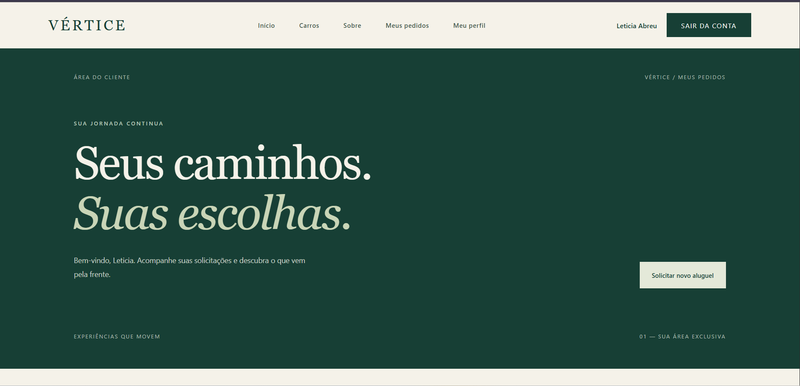

### T05 — Catálogo de automóveis

**Resultado identificado:** interface para consulta dos automóveis cadastrados.

**Situação:** VALIDAÇÃO DOCUMENTAL.

### T06 — Disponibilidade

**Resultado identificado:** consulta de disponibilidade e períodos ocupados.

**Situação:** VALIDAÇÃO DOCUMENTAL.

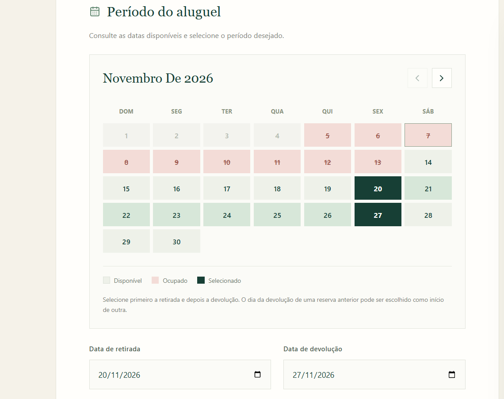

### T07 — Criação de pedido

**Resultado identificado:** operação de criação de solicitações de aluguel.

**Situação:** VALIDAÇÃO DOCUMENTAL.

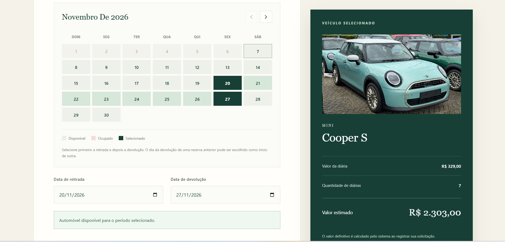

### T08 — Consulta de pedidos

**Resultado identificado:** consulta das solicitações e seus respectivos status.

**Situação:** VALIDAÇÃO DOCUMENTAL.

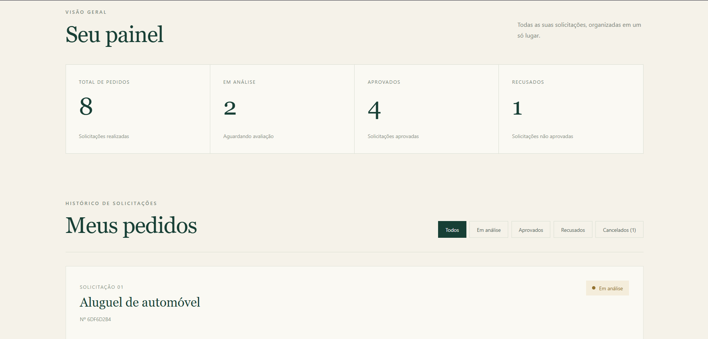

### T09 — Alteração de pedido

**Resultado identificado:** operação de atualização de solicitações permitidas.

**Situação:** VALIDAÇÃO DOCUMENTAL.

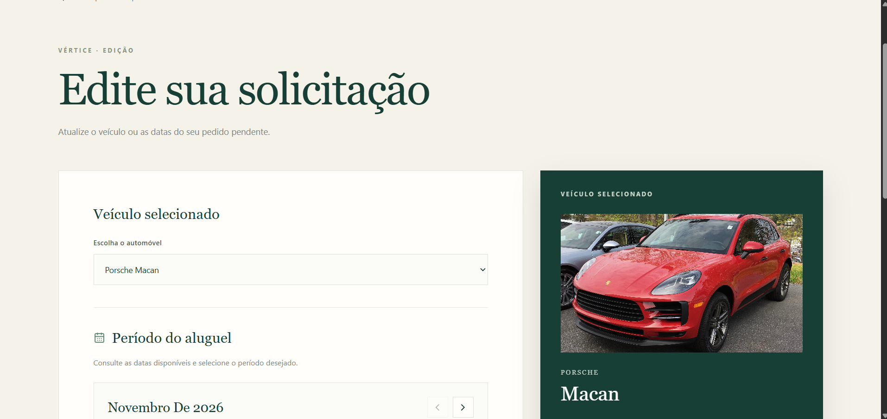

### T10 — Cancelamento de pedido

**Resultado identificado:** operação de cancelamento de pedidos elegíveis.

**Situação:** VALIDAÇÃO DOCUMENTAL.

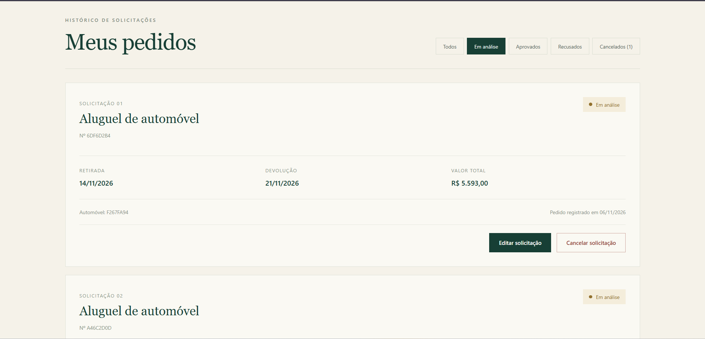

### T11 — Atualização de perfil

**Resultado identificado:** manutenção de dados cadastrais e profissionais.

**Situação:** VALIDAÇÃO DOCUMENTAL.

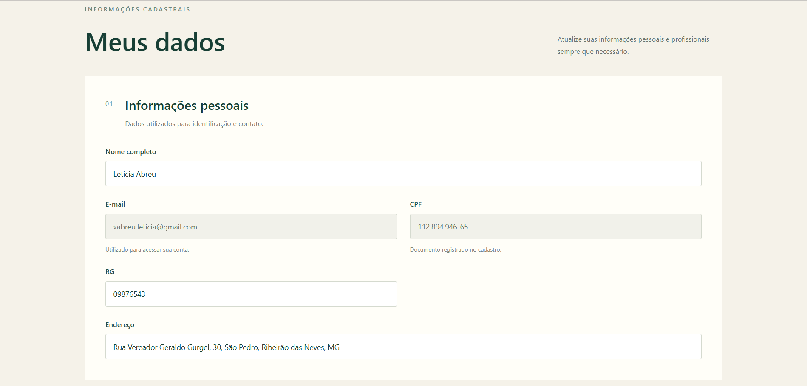

### T12 — Limite de empregos

**Resultado identificado:** restrição de até três vínculos empregatícios.

**Situação:** VALIDAÇÃO DOCUMENTAL.

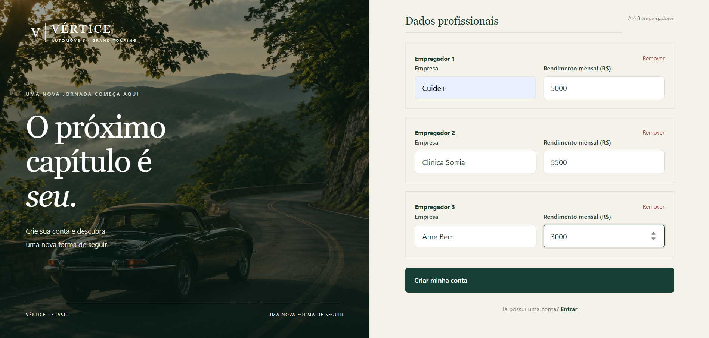

### T13 — Parecer financeiro

**Resultado identificado:** funcionalidade de registro de parecer financeiro.

**Situação:** VALIDAÇÃO DOCUMENTAL.

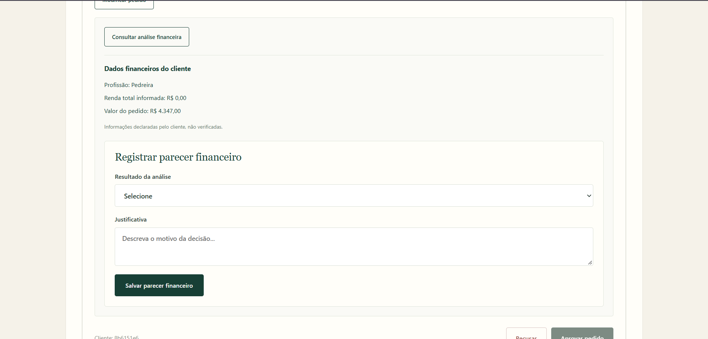

### T14 — Decisão empresarial

**Resultado identificado:** operações de aprovação e recusa empresarial.

**Situação:** VALIDAÇÃO DOCUMENTAL.

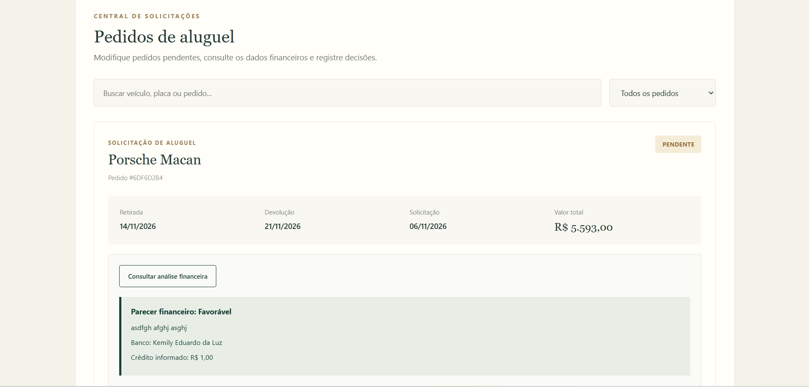

### T15 — Decisão bancária

**Resultado identificado:** operações de avaliação e decisão de crédito.

**Situação:** VALIDAÇÃO DOCUMENTAL.

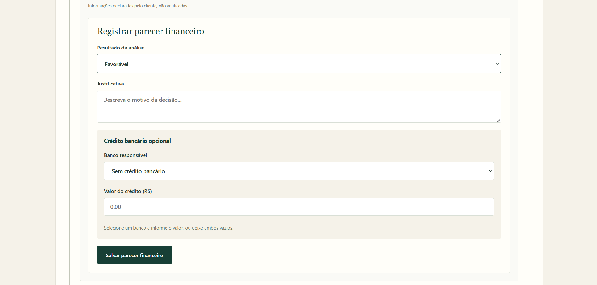

### T16 — Contrato PDF

**Resultado identificado:** funcionalidade de consulta e geração de contratos em PDF.

**Situação:** VALIDAÇÃO DOCUMENTAL.

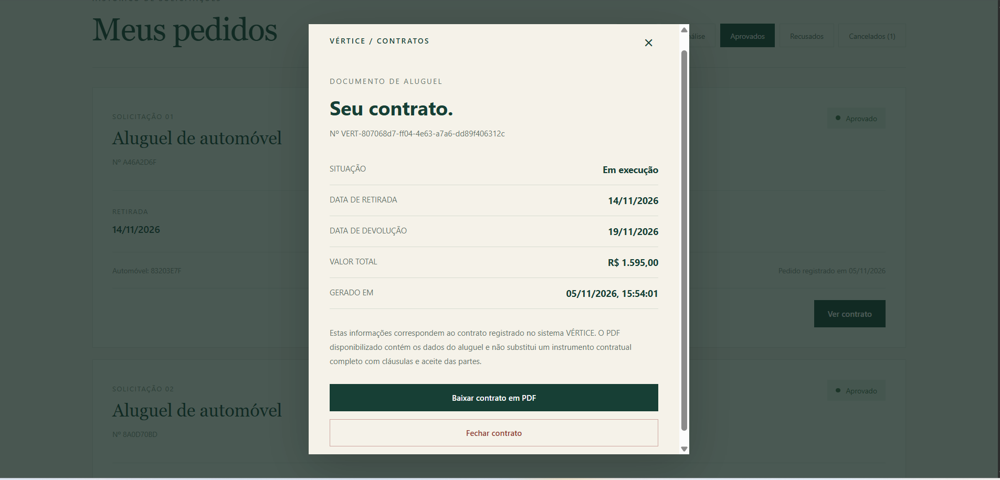

### T17 — Cadastro de agente

**Resultado identificado:** cadastro administrativo de agentes de empresa e banco.

**Situação:** VALIDAÇÃO DOCUMENTAL.

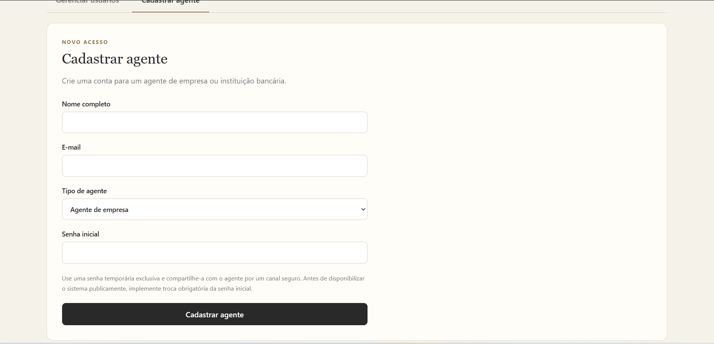

### T18 — Gerenciamento de usuários

**Resultado identificado:** consulta e atualização administrativa de usuários.

**Situação:** VALIDAÇÃO DOCUMENTAL.

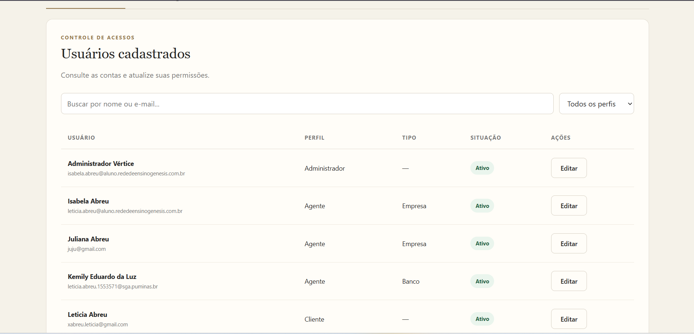

## 6. Resumo da validação

| Indicador | Quantidade |
|---|---:|
| Cenários documentados | 20 |
| Cenários com funcionamento confirmado | 1 |
| Cenários com validação documental | 19 |
| Cenários com reprovação registrada | 0 |

A confirmação de funcionamento contempla a autenticação e o acesso aos quatro perfis implementados.

As demais funcionalidades foram identificadas na implementação e descritas conforme os comportamentos previstos.

A classificação documental não representa aprovação em teste de execução.

## 7. Apresentação final

A apresentação do VÉRTICE será organizada em oito etapas.

### Slide 1 — Identificação

Apresentação do projeto, instituição, disciplina e integrantes.

### Slide 2 — Problema e solução

Contextualização do processo de aluguel de automóveis e apresentação da solução desenvolvida.

### Slide 3 — Protótipo inicial

Apresentação das sete telas do Figma utilizadas no planejamento da interface.

### Slide 4 — Modelagem UML

Apresentação dos diagramas de casos de uso, classes e pacotes.

### Slide 5 — Tecnologias e arquitetura

Explicação da integração entre React, Spring Boot, Spring Security e PostgreSQL/Supabase.

### Slide 6 — Evolução do sistema

Comparação entre as interfaces iniciais do Figma e as telas implementadas.

### Slide 7 — Demonstração funcional

Demonstração dos principais fluxos:

1. Login do cliente.
2. Consulta de automóveis.
3. Criação de pedido.
4. Análise empresarial.
5. Decisão bancária.
6. Consulta de contrato.
7. Administração de usuários.

### Slide 8 — Resultados e conclusão

Apresentação dos principais recursos desenvolvidos, das tecnologias integradas e da evolução do protótipo.

## 8. Conclusão

O VÉRTICE apresenta uma implementação que contempla as principais funcionalidades previstas para o Laboratório 02, incluindo autenticação, cadastro de clientes, consulta de automóveis, gerenciamento de pedidos, análise financeira, avaliação bancária, contratos e administração.

O acesso aos quatro perfis foi confirmado durante o desenvolvimento.

A documentação identifica os comportamentos implementados e organiza os cenários necessários para a validação funcional.

A arquitetura utiliza React e Vite no front-end, Spring Boot no back-end e PostgreSQL/Supabase para persistência, com controle de autenticação e autorização pelo Spring Security.

As evidências visuais complementam a documentação, permitindo demonstrar as funcionalidades e apoiar a apresentação final.

A aprovação formal dos demais cenários depende da verificação de seus resultados durante a execução.
