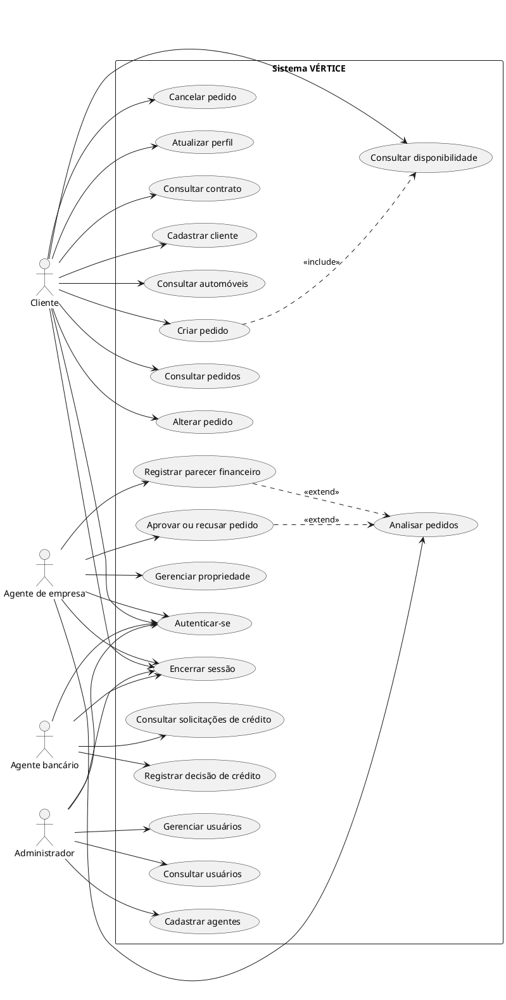

# Diagrama de Casos de Uso — VÉRTICE

## 1. Objetivo

Representar as funcionalidades oferecidas pelo sistema e suas interações com os atores.

## 2. Atores

- Cliente
- Agente de empresa
- Agente bancário
- Administrador

## 3. Casos de uso

| ID | Caso de uso | Ator principal |
|---|---|---|
| UC01 | Cadastrar cliente | Cliente |
| UC02 | Autenticar-se | Todos |
| UC03 | Encerrar sessão | Todos |
| UC04 | Consultar automóveis | Cliente |
| UC05 | Consultar disponibilidade | Cliente |
| UC06 | Criar pedido | Cliente |
| UC07 | Consultar pedidos | Cliente |
| UC08 | Alterar pedido | Cliente |
| UC09 | Cancelar pedido | Cliente |
| UC10 | Atualizar perfil | Cliente |
| UC11 | Consultar contrato | Cliente |
| UC12 | Analisar pedidos | Agente de empresa |
| UC13 | Registrar parecer financeiro | Agente de empresa |
| UC14 | Aprovar ou recusar pedido | Agente de empresa |
| UC15 | Gerenciar propriedade | Agente de empresa |
| UC16 | Consultar solicitações de crédito | Agente bancário |
| UC17 | Registrar decisão de crédito | Agente bancário |
| UC18 | Consultar usuários | Administrador |
| UC19 | Cadastrar agentes | Administrador |
| UC20 | Gerenciar usuários | Administrador |

## 4. Diagrama UML

O código PlantUML abaixo pode ser renderizado com a extensão PlantUML do VS Code ou em um renderizador compatível.

## 5. Especificação de casos de uso

### UC02 — Autenticar-se

**Ator:** usuário cadastrado.

**Pré-condição:** possuir conta cadastrada e ativa.

**Fluxo principal:**

1. O usuário acessa a tela de login.
2. Informa e-mail e senha.
3. O sistema valida as credenciais.
4. O sistema identifica o perfil.
5. O usuário acessa sua área autorizada.

**Fluxo alternativo:** credenciais inválidas ou conta sem permissão impedem o acesso.

**Pós-condição:** sessão autenticada.

### UC06 — Criar pedido

**Ator:** cliente.

**Pré-condições:** cliente autenticado e automóvel identificado.

**Fluxo principal:**

1. O cliente consulta os automóveis.
2. Seleciona o veículo.
3. Informa o período desejado.
4. O sistema valida a solicitação.
5. O pedido é registrado.
6. O sistema apresenta o status inicial.

**Fluxo alternativo:** dados inválidos ou indisponibilidade impedem a criação.

**Pós-condição:** pedido registrado.

### UC13 — Registrar parecer financeiro

**Ator:** agente de empresa.

**Pré-condição:** pedido elegível para análise.

**Fluxo principal:**

1. O agente acessa a solicitação.
2. Consulta as informações financeiras.
3. Registra o parecer.
4. O sistema valida e persiste o resultado.

**Pós-condição:** parecer associado ao pedido.

### UC17 — Registrar decisão de crédito

**Ator:** agente bancário.

**Pré-condição:** solicitação encaminhada para análise de crédito.

**Fluxo principal:**

1. O agente consulta as solicitações.
2. Seleciona o pedido.
3. Registra a decisão.
4. O sistema atualiza o status de crédito.

**Pós-condição:** decisão registrada.

### UC19 — Cadastrar agentes

**Ator:** administrador.

**Pré-condição:** sessão administrativa autenticada.

**Fluxo principal:**

1. O administrador acessa o painel.
2. Seleciona a opção de cadastrar agente.
3. Informa os dados e o tipo de agente.
4. O sistema valida as informações.
5. A conta é criada com o perfil correspondente.

**Pós-condição:** agente cadastrado.
