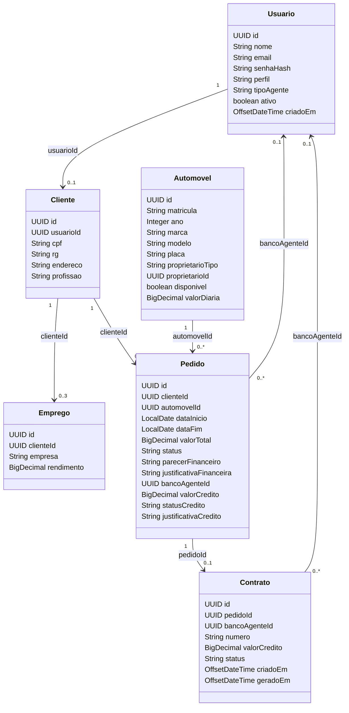

# Diagrama de Classes — VÉRTICE

## 1. Objetivo

Representar as principais entidades do domínio, seus atributos e relacionamentos.

## 2. Diagrama de classes

## 3. Descrição das classes

### Usuario

Representa a conta de acesso ao sistema.

Armazena identificação, credenciais protegidas, perfil, tipo de agente e situação da conta.

### Cliente

Representa os dados cadastrais e profissionais do contratante.

Possui referência ao usuário responsável pela conta.

### Emprego

Representa um vínculo empregatício do cliente.

Armazena informações do empregador e do rendimento informado.

### Automovel

Representa o veículo disponível para operações de aluguel.

Contém dados de identificação, disponibilidade, valor de diária e titularidade.

### Pedido

Representa uma solicitação de aluguel.

Contém dados do período, veículo, cliente, valor, status e informações de análise financeira e bancária.

### Contrato

Representa a formalização de um aluguel.

Está associado a um pedido e pode conter informações de crédito.

## 4. Relacionamentos

| Origem | Destino | Relacionamento |
|---|---|---|
| Usuario | Cliente | Uma conta pode possuir cadastro de cliente |
| Cliente | Emprego | Um cliente pode informar até três empregos |
| Cliente | Pedido | Um cliente pode realizar vários pedidos |
| Automovel | Pedido | Um automóvel pode participar de diferentes pedidos |
| Pedido | Contrato | Um pedido pode originar um contrato |
| Usuario | Pedido | Um agente bancário pode estar associado à análise |
| Usuario | Contrato | Um agente bancário pode estar associado ao crédito |

## 5. Observações de implementação

- Os identificadores utilizam UUID.
- As entidades são persistidas no PostgreSQL.
- Os relacionamentos apresentados são lógicos.
- A regra de até três empregos é uma restrição de negócio.
- A existência de vários pedidos para um automóvel não implica disponibilidade simultânea.
- A validação dos períodos é responsabilidade das regras de negócio.

## 6. Alinhamento com o código

As classes representadas correspondem aos arquivos:

- model/Usuario.java
- model/Cliente.java
- model/Emprego.java
- model/Automovel.java
- model/Pedido.java
- model/Contrato.java

Este diagrama apresenta o modelo de domínio, não todas as classes de infraestrutura, controllers, services ou métodos gerados por bibliotecas.
