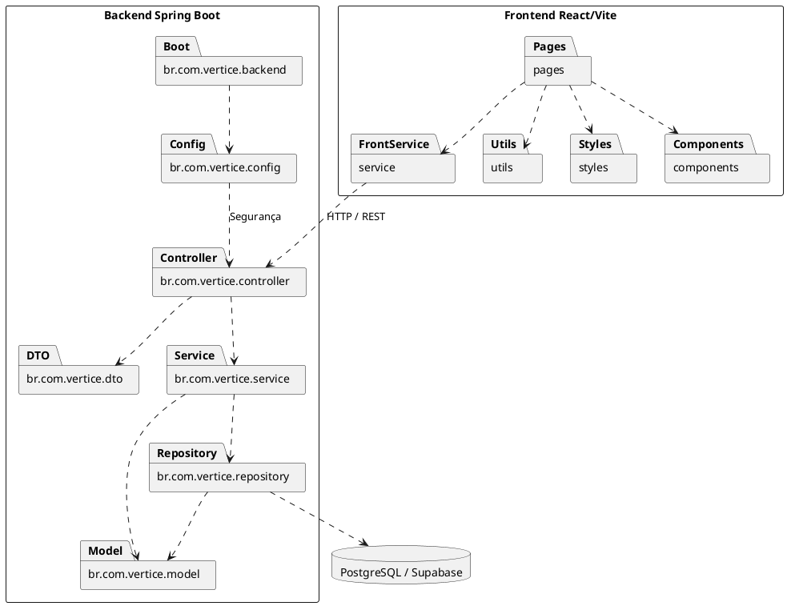

# Diagrama de Pacotes — VÉRTICE

## 1. Objetivo

Representar a organização lógica da aplicação e as dependências entre os pacotes.

## 2. Diagrama UML de pacotes

## 3. Responsabilidades

### Front-end

**pages:** páginas da aplicação e interfaces dos perfis.

**components:** componentes reutilizáveis.

**service:** comunicação com os serviços HTTP.

**utils:** funções auxiliares.

**styles:** estilos visuais.

### Back-end

**backend:** inicialização do Spring Boot.

**config:** configuração de segurança, filtros e inicialização administrativa.

**controller:** exposição dos endpoints REST.

**dto:** estruturas de entrada de dados.

**service:** regras de negócio.

**repository:** persistência e consultas.

**model:** entidades de domínio.

## 4. Padrão arquitetural

O sistema segue uma arquitetura cliente-servidor.

O back-end utiliza separação de responsabilidades compatível com uma organização MVC em camadas, enquanto o front-end React funciona como aplicação independente.

A comunicação entre as partes é realizada por requisições HTTP à API REST.

## 5. Banco de dados

O banco PostgreSQL está hospedado no Supabase.

O acesso aos dados ocorre através do Spring Data JPA e dos repositórios do back-end.

## 6. Benefícios

- Separação de responsabilidades.
- Organização do código.
- Facilidade de manutenção.
- Reutilização de componentes.
- Isolamento das regras de negócio.
- Controle centralizado de segurança.
