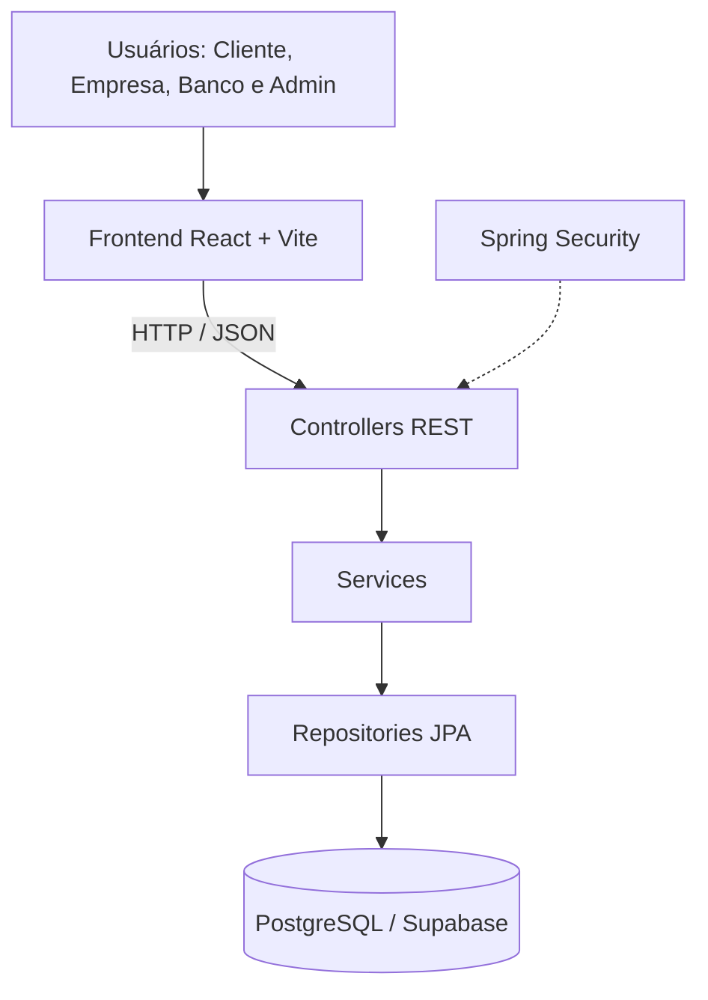
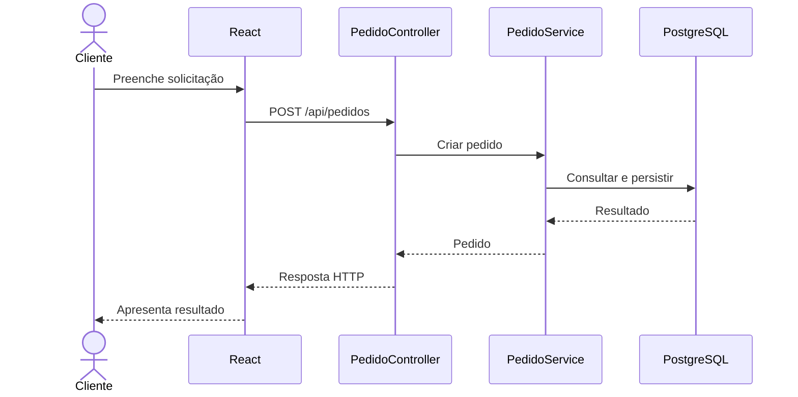

# Arquitetura do Sistema — VÉRTICE

## 1. Visão geral

O VÉRTICE utiliza uma arquitetura web cliente-servidor, composta por front-end, API REST e banco de dados.

O front-end é responsável pela interação com os usuários. O back-end executa autenticação, validações, regras de negócio e persistência.

## 2. Diagrama de arquitetura

## 3. Camadas

### Apresentação

Desenvolvida com React e Vite.

Responsável por:
- Exibir formulários e páginas.
- Permitir navegação.
- Apresentar mensagens e resultados.
- Consumir endpoints do back-end.

### Controle

Implementada pelos controllers Spring.

Responsável por:
- Receber requisições.
- Identificar endpoints.
- Encaminhar operações aos serviços.
- Retornar respostas HTTP.

### Negócio

Implementada pelos services.

Responsável por:
- Validar operações.
- Aplicar regras financeiras.
- Verificar situações dos pedidos.
- Processar decisões.
- Coordenar persistência.

### Persistência

Implementada pelos repositories Spring Data JPA.

Responsável por:
- Consultar registros.
- Salvar entidades.
- Recuperar informações do banco.

### Dados

Implementada por entidades JPA e PostgreSQL.

## 4. Fluxo de criação de pedido

## 5. Fluxo de análise

1. O cliente registra um pedido.
2. O pedido fica disponível para análise conforme as permissões.
3. O agente de empresa consulta a solicitação.
4. O agente registra o parecer financeiro.
5. Quando aplicável, a solicitação passa pela avaliação bancária.
6. O agente bancário registra a decisão de crédito.
7. A empresa registra a decisão sobre o pedido.
8. O contrato pode ser formalizado após a aprovação.

## 6. Segurança

A aplicação utiliza Spring Security.

Os principais mecanismos são:
- Sessões HTTP.
- Autenticação por e-mail e senha.
- Hash BCrypt.
- Proteção CSRF.
- Autorização baseada em perfis.
- Verificação de conta ativa.

As credenciais do banco e outras informações sensíveis devem permanecer em variáveis de ambiente não versionadas.

## 7. Tecnologias

- Java 25
- Spring Boot 4.0.9
- Spring Security
- Spring Data JPA
- Hibernate
- Maven
- React
- Vite
- Axios
- PostgreSQL
- Supabase

## 8. Considerações

A separação entre interface, controle, negócio e persistência facilita a manutenção e a evolução da aplicação.

A API REST permite que o front-end e o back-end sejam desenvolvidos como aplicações independentes.
