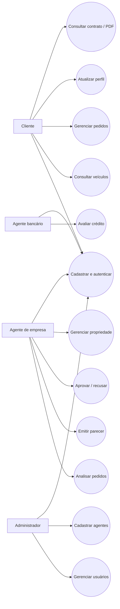

# Diagrama de casos de uso — versão final

O diagrama abaixo é uma **visão funcional simplificada**, derivada dos endpoints e das páginas do projeto. Para uma notação UML estrita, use também o arquivo PlantUML `casos-de-uso.puml`.

**Fonte:** `AuthController`, `PedidoController`, `AgenteController`, `BancoController`, `AdminController`, `ContratoController`, `PerfilClienteController`, `AutomovelController` e `ProprietarioAutomovelController`.
