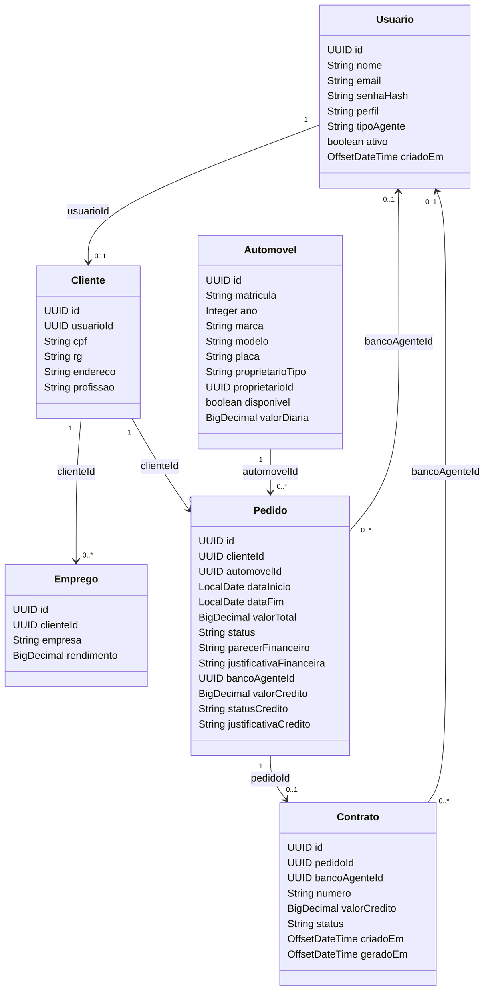

# Diagrama de classes — modelo de domínio final

Os atributos abaixo foram extraídos das seis entidades JPA existentes em `backend/src/main/java/br/com/vertice/model/`. Os vínculos são **associações lógicas por UUID**, não necessariamente associações JPA com `@ManyToOne`.

**Atenção:** cardinalidades representam a interpretação do domínio a partir das chaves e dos serviços. A regra do enunciado de **até três empregadores** deve ser validada nas regras efetivas de cadastro/edição; não é uma cardinalidade automaticamente imposta pelo diagrama.
