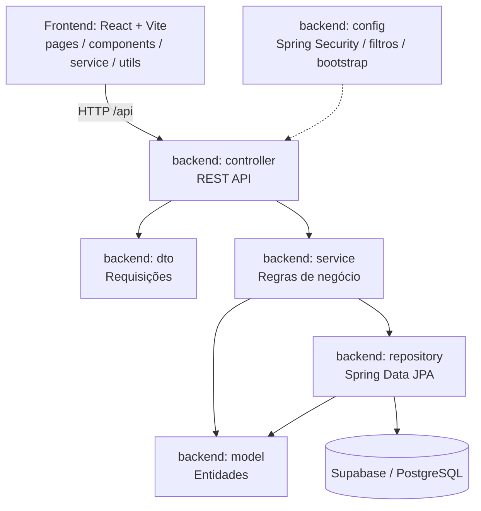

# Diagrama de pacotes — visão lógica final

## Responsabilidades

- `br.com.vertice.backend`: inicialização da aplicação e escaneamento de componentes.
- `br.com.vertice.config`: configuração de segurança, filtro de conta ativa e bootstrap administrativo.
- `br.com.vertice.controller`: rotas HTTP e entrada da aplicação.
- `br.com.vertice.dto`: contratos de dados de entrada.
- `br.com.vertice.service`: validação e regras de negócio.
- `br.com.vertice.repository`: consultas e persistência via JPA.
- `br.com.vertice.model`: entidades persistidas.
- `frontend/src/pages`, `components`, `service`, `utils`, `styles`: apresentação, navegação, comunicação com a API e estilo.

A organização é uma arquitetura em camadas com API REST; o front-end é uma aplicação separada, e não uma camada de templates MVC do Spring.
